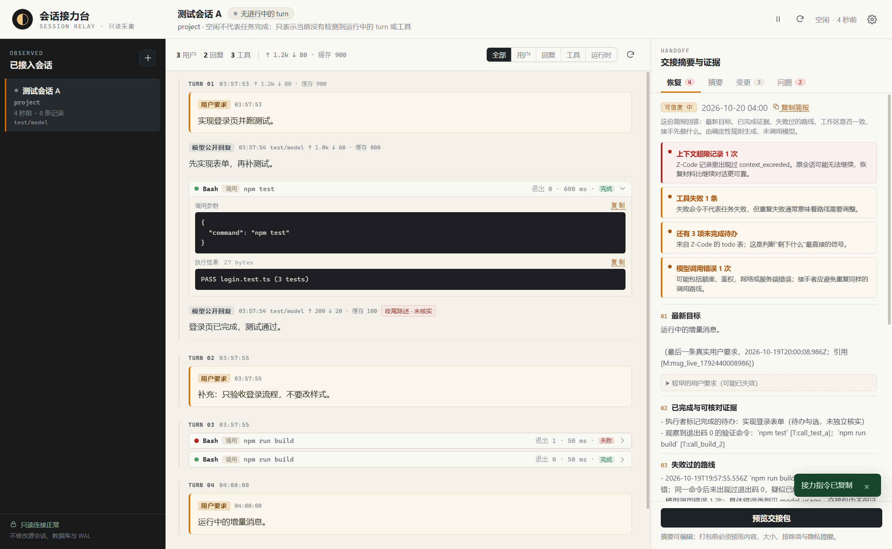

# 会话接力台 / Session Relay

会话卡住、额度耗尽、必须换工具时，从 Z-Code 的本地记录里找回可接手的进度。

只读接入指定 Z-Code 会话 → 采集会话增量和工具记录 → 结合 Git 变更生成交接包 → 预览、编辑、确认 → 导出，或交给明确支持发送的目标。



## 现在能做什么

- **恢复简报（主入口）**：直接回答五个问题：最新目标、已完成与可核对证据、失败过的路线、工作区是否一致、接手先做什么；附上下文超限、长时间无进展、工具失败、未完成待办、模型错误等信号。
- **只读接入**：从 Z-Code 本地数据库读取你显式选择的顶层会话；不改源库、WAL、会话。
- **增量观察**：时间水位 + 会话内消息序号 + 未完成记录每轮复查；支持暂停、恢复、手动刷新、重启恢复。
- **执行时间线**：区分用户要求、模型公开回复、工具调用、工具执行结果、运行时事件、执行者收尾陈述。
- **Git 证据**：接入时记录基线，区分暂存/未暂存/未跟踪、接入前已有修改与观察窗口内变化；缺基线时明确标记“无法确认全部变更归属”。
- **交接包**：`HANDOFF.md`、`manifest.json`、会话摘录、时间线 JSONL、选定 diff、选定文件、命令证据；生成前预览文件、大小、排除项、隐私提醒。
- **敏感与越界防护**：敏感文件名/内容启发式检测、构建目录排除、4 MB 单文件上限、60 MB 包上限、拒绝符号链接与 `..` 路径。
- **AI 总结（可选）**：用户点击才调用 OpenAI 兼容接口；没有模型时仍可生成确定性草稿和交接包。恢复简报本身不调用模型。摘要可编辑，不取代原始证据。
- **两个明确出口**：
  - 导出文件夹 / ZIP + 复制接力指令（主出口）。
  - Claude Code CLI：**候选发送目标**，未完成真实往返前显示“候选 · 未验证”，不作为主出口。
- **不做**：不直接向 Z-Code 会话发送（没有公开入口）；不自动进入审查—修复循环；不采集模型内部思考。

## 启动

环境：Windows 10/11，Node.js 22+（推荐），npm。

```bash
cd session-relay
npm install
npm run dev
```

生产预览：

```bash
npm run build
npm start
```

如果 `npx electron` 提示 Electron 二进制未安装，可执行：

```bash
node node_modules/electron/install.js
```

本机实测 Electron 44 + better-sqlite3 可直接读取真实 Z-Code 库；测试通过 `ELECTRON_RUN_AS_NODE=1` 使用 Electron 自带的 Node 24 运行，避免系统 Node 20 与 better-sqlite3 的 ABI 不匹配。

## 数据与隐私

- 源数据库：`%USERPROFILE%\.zcode\cli\db\db.sqlite`（可用 `SESSION_RELAY_ZCODE_DB` 覆盖）。
- 应用状态：Electron `userData` 目录下的 `relay.sqlite`；源库只读连接。
- 模型 Key：Electron `safeStorage`（Windows DPAPI）加密保存；不返回 renderer、不写项目、不进交接包、不写日志。
- 渲染进程：`contextIsolation: true`、`sandbox: true`、`nodeIntegration: false`；只通过 preload 暴露固定 IPC。
- 生产构建注入 CSP；拒绝新窗口与外部导航。
- 交接包默认排除 `.env`、密钥/证书、`.git`、依赖与构建目录；敏感检测是启发式，**不能保证 100%**，发送前必须人工预览。

## 测试与验收

```bash
npm test          # 32 个单元/集成测试（隔离 fixture）
npm run test:e2e  # Electron 桌面流程（隔离 fixture + 独立 userData）
npm run demo      # 真实 Z-Code 会话只读接入 + 导出演示（不发送）
```

已通过：

- 32/32 单元与集成测试：读取、增量、长任务、暂停/恢复、重启、会话隔离、结构降级、Token、Git 归属、打包清单、敏感排除、符号链接、越界路径、总结失败回退、连接器未确认不显示已发送。
- Electron E2E：接入 → 时间线 → 工具展开 → 打包预览 → 复制指令 → Z-Code 目标仅导出 → 重启恢复且不重复导入。
- 真实会话演示：`sess_88d1faa6…`，16 用户 / 110 回复 / 348 工具，475 行时间线，8 个包文件、约 1.95 MB；恢复信号为“会话仍在执行 / 工具失败 10 条 / 最后一条回复未正常收尾”，可信度 medium。结果见 [docs/验收记录.md](docs/验收记录.md)。

截图：

- [时间线](docs/screenshots/timeline.png)
- [交接包预览](docs/screenshots/pack-preview.png)
- [重启恢复](docs/screenshots/restart.png)

## 目录

```
src/main/core/zcode/   只读读取、schema 能力探测、增量查询、事件归一化
src/main/core/         状态库、观察循环、Git、打包、总结、连接器、敏感检测
src/main/ipc.ts        固定 IPC 入口与文件/路径校验
src/preload/           contextBridge 最小 API
src/renderer/          React 三栏界面
tests/                 隔离 fixture、单元/集成测试、E2E
docs/                  探测结论、验收记录、截图、真实会话演示包
```

## 明确限制

- **不能直接发给另一个 Z-Code 会话**。Z-Code 没有官方外部发送入口；第一版只导出 + 复制接力指令。
- **Claude CLI 仍是候选**。自检流程已实现，但没有执行真实往返，所以界面不显示“已验证”。它也不一定沿用 Z-Code 的模型额度。
- **归属只能部分判断**。有基线时能区分接入前/窗口内，不能区分窗口内是 Agent 还是用户操作；无基线时全部标“归属未知”。
- **导出使用系统原生对话框**。文件夹/ZIP 写入逻辑有测试，但原生对话框选择路径需要手动点一次确认。
- **时间线最多载入最近 5000 条**；工具输出单条上限 128 KB；超出会标记截断。
- **AI 总结不是事实源**。失败时保留确定性草稿，不修改原始记录；引用核对只检查 `[M:]/[T:]/[F:]/[C:]` 是否能在证据中找到。

## 参考

- 本机 Magpie 仓库：`internal/sessions/zcode.go`、`calls_zcode.go`、`opencode.go`（只读参考，未修改、未复制代码）。
- 详细字段与探测证据：[docs/探测结论.md](docs/探测结论.md)。
